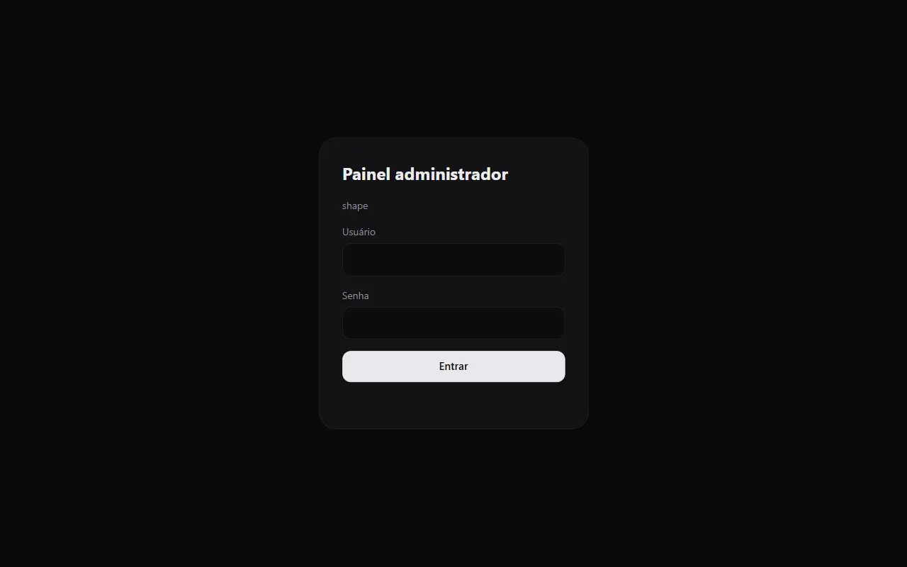

<!-- readme-padrao -->
# Shape AI

> Coach de treino, dieta e evolução com IA, no celular. Monta o treino (com vídeo de cada exercício) e a dieta casados com a rotina da pessoa, calcula o BF, acompanha medidas e fotos, organiza a tirzepatida pela planilha da doutora e, a partir da foto da receita do médico, monta a aba Hormônios (ampolas, doses, gráfico da curva, calendário e guia de aplicação). Tem ranking semanal com pontos e níveis. Pro R$ 39,90 e Elite R$ 79,90 pela Cakto.


## O que é
Coach de treino, dieta e evolução com IA, no celular. Monta o treino (com vídeo de cada exercício) e a dieta casados com a rotina da pessoa, calcula o BF, acompanha medidas e fotos, organiza a tirzepatida pela planilha da doutora e, a partir da foto da receita do médico, monta a aba Hormônios (ampolas, doses, gráfico da curva, calendário e guia de aplicação). Tem ranking semanal com pontos e níveis. Pro R$ 39,90 e Elite R$ 79,90 pela Cakto.

Estado: **no ar**. Produto da Rangel Tech, vendido pela Cakto (conta do Lucas). Registro único dos produtos: `vps_rt_infra/registro/produtos.yml` (spec 57).

## Onde está no ar
- https://shape.rangeltech.net
- https://shape-ai.rangeltech.net

**Painel do administrador:** `https://shape.rangeltech.net/admin` (login único dos produtos; a credencial está no Infisical, `rt-produtos/_admin`).



O usuário de teste (QA) de cada produto é obtido no painel único (`painel.rangeltech.net`, aba do produto).

## Onde faz o deploy
Este repositório **só publica** o artefato; **quem implanta é o `vps_rt_infra`** (nenhum container é trocado à mão).

1. Publicar a release: criar a tag (`v*`); o workflow `.github/workflows/release.yml` gera a imagem e o `release-manifest.json` e publica como release.
2. Implantar (de madrugada, 00h às 06h de Brasília): `gh workflow run deploy.yml --repo RangelTech/vps_rt_infra -f service=shapeai`
   - Só validar, sem implantar: acrescentar `-f dry_run=true`.
3. Voltar uma versão (rollback): `gh workflow run deploy.yml --repo RangelTech/vps_rt_infra -f service=shapeai -f version=<tag-antiga>`.

O serviço no mapa de releases é `shapeai` (`vps_rt_infra/releases/sources.json`).

## Como funciona por dentro
- **API e site:** FastAPI (Python) em `app/`, com a landing em `static/`. Container único (`Dockerfile`).
- **Dados:** hoje SQLite no volume do container; **está planejada a migração** para o banco `produtos` do Postgres (um schema por produto) e dos arquivos para o MinIO (spec 57, seções 8 e 8.6).
- **IA:** fala com o Qwen pelo `llm-access` (chave por produto).
- **Cobrança:** webhook da Cakto (`/api/cakto` ou rota equivalente) libera o plano; a conciliação diária compara pedidos e assinaturas.
- **Login:** hoje por código no e-mail; passa para e-mail e senha com captcha invisível e "entrar por link" (spec 57, seção 5A).

## Segredos
Só os **nomes** das variáveis estão neste repositório, em [`segredos.yml`](segredos.yml). Os **valores** ficam no Infisical (projeto `rt-produtos`, ambiente `prod`, pasta `shapeai`) e chegam à VPS **gerados no momento do deploy**. Nunca coloque valor de segredo no git.

## Rodar e testar localmente
```bash
python -m venv .venv && source .venv/bin/activate   # no Windows: .venv\Scripts\activate
pip install -r requirements.txt
pytest
```
Os testes de QA em produção são por cliques reais (relatório em PDF no `new_ragente/qa/evidencias`).

## Links
- Painel único: https://painel.rangeltech.net (aba do produto: links, usuário de QA, planos)
- Spec de organização geral: `new_ragente/specs/57_ORGANIZACAO_GERAL_PRODUTOS_E_PAINEL.md`
- Monitor: Uptime Kuma, `shapeai`
